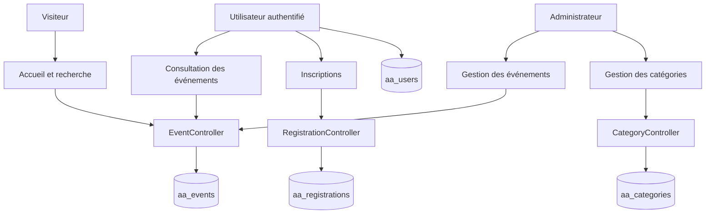

# EventPlanner

> Application web Laravel pour découvrir, créer et gérer des événements, avec inscription des participants et espace d'administration.

[](https://laravel.com/)
[](https://www.php.net/)
[](https://tailwindcss.com/)

## Sommaire

- [Présentation](#présentation)
- [Fonctionnalités](#fonctionnalités)
- [Stack technique](#stack-technique)
- [Architecture](#architecture)
- [Installation](#installation)
- [Configuration](#configuration)
- [Exécution](#exécution)
- [Règles métier](#règles-métier)
- [Tests](#tests)

## Présentation

EventPlanner est une application Laravel de découverte et de réservation d'événements. Les visiteurs peuvent parcourir les événements disponibles, les rechercher et les filtrer. Les utilisateurs authentifiés peuvent consulter les détails d'un événement, s'y inscrire et gérer leurs inscriptions depuis leur tableau de bord.

Un espace administrateur permet de gérer les événements et les catégories, avec possibilité d'ajouter une image, de définir une capacité, un prix et une période.

## Fonctionnalités

### Visiteurs et utilisateurs

- Page d'accueil avec présentation des événements à venir.
- Recherche par titre ou description.
- Filtrage par jours ouvrés, week-ends et catégorie.
- Chargement progressif des événements avec pagination asynchrone.
- Consultation de la fiche détaillée et des événements associés.
- Inscription et désinscription à un événement.
- Tableau de bord listant les inscriptions de l'utilisateur.
- Profil utilisateur et modification des informations personnelles.
- Authentification, vérification d'adresse email et réinitialisation du mot de passe.

### Administrateurs

- Tableau de bord des inscriptions.
- Création, modification et suppression d'événements.
- Gestion de la date de début, de fin, du lieu, de la capacité et du prix.
- Gestion des événements gratuits ou payants.
- Téléversement d'une image d'événement.
- Création, modification et suppression de catégories.
- Pagination des listes d'événements, catégories et inscriptions.
- Protection des routes d'administration par middleware dédié.

## Stack technique

| Domaine | Technologies |
| --- | --- |
| Framework | Laravel 12 |
| Langage | PHP 8.2+ |
| Interface | Blade, Tailwind CSS |
| Interactivité | Alpine.js |
| Assets | Vite, Laravel Vite Plugin |
| Base de données | SQLite par défaut, MySQL compatible |
| Authentification | Laravel Breeze |
| ORM | Eloquent |
| Tests | Pest, PHPUnit |
| Qualité | Laravel Pint |

## Architecture



Le code applicatif est organisé par responsabilité :

```text
app/
├── Http/Controllers/       # Événements, catégories, inscriptions, profil et auth
├── Http/Middleware/        # Contrôle du rôle administrateur
├── Http/Requests/          # Validation des événements et du profil
├── Models/                 # User, Event, Category et Registration
└── View/Components/        # Layouts Blade et composants d'interface
database/migrations/        # Schéma des utilisateurs, événements et inscriptions
resources/views/
├── auth/                   # Connexion, inscription et récupération de compte
├── categories/             # Vues de gestion des catégories
├── events/                 # Catalogue et administration des événements
├── layouts/                # Layouts site, application et invité
└── dashboard.blade.php     # Inscriptions de l'utilisateur ou de l'admin
routes/
├── web.php                 # Routes métier et administration
└── auth.php                # Routes d'authentification Breeze
```

## Installation

### Prérequis

- PHP `8.2` ou supérieur ;
- Composer ;
- Node.js et npm ;
- SQLite ou une base de données compatible Laravel.

### Installation rapide

Le script `setup` prépare l'application, génère la clé, exécute les migrations, installe les dépendances front-end et construit les assets :

```bash
git clone https://github.com/AichaAbdennadher/projetDS.git
cd projetDS
composer run setup
```

### Installation manuelle

```bash
composer install
cp .env.example .env
php artisan key:generate
php artisan migrate
npm install
npm run build
```

## Configuration

La configuration par défaut utilise SQLite :

```dotenv
DB_CONNECTION=sqlite
```

Si le fichier n'existe pas encore, créez-le avant la migration :

```bash
touch database/database.sqlite
php artisan migrate
```

Pour utiliser MySQL, adaptez les variables `DB_*` dans `.env`. En développement, les emails sont écrits dans les logs avec :

```dotenv
MAIL_MAILER=log
```

Ne commitez jamais un fichier `.env` réel ou des secrets de production.

## Exécution

Pour lancer uniquement le serveur Laravel :

```bash
php artisan serve
```

Pour lancer l'environnement complet avec serveur Laravel, queue, logs et Vite :

```bash
composer run dev
```

L'application est accessible par défaut à l'adresse [http://localhost:8000](http://localhost:8000).

## Routes principales

| Méthode | Route | Accès | Description |
| --- | --- | --- | --- |
| `GET` | `/` | Public | Catalogue des événements |
| `GET` | `/events/{id}` | Authentifié | Détails d'un événement |
| `POST` | `/events/{id}/register` | Authentifié | S'inscrire |
| `DELETE` | `/events/{id}/unregister` | Authentifié | Annuler une inscription |
| `GET` | `/dashboard` | Authentifié | Voir les inscriptions |
| `GET/PATCH` | `/profile` | Authentifié | Consulter et modifier le profil |
| `GET/POST/...` | `/admin/events` | Admin | Administrer les événements |
| `GET/POST/...` | `/admin/categories` | Admin | Administrer les catégories |

## Règles métier

- Un utilisateur ne peut s'inscrire qu'une seule fois au même événement.
- Une inscription est refusée lorsque la capacité disponible est épuisée.
- La capacité est décrémentée à l'inscription et restaurée à l'annulation.
- Une annulation est autorisée au moins sept jours avant le début de l'événement.
- La date de fin doit être postérieure à la date de début.
- Un événement gratuit a automatiquement un prix égal à zéro.
- Une catégorie contenant des événements ne peut pas être supprimée avant ceux-ci.

## Tests

Lancer les tests :

```bash
composer run test
```

Ou directement avec Artisan :

```bash
php artisan test
```

Vérifier le style PHP :

```bash
vendor/bin/pint --test
```

Construire les assets de production :

```bash
npm run build
```

## Licence

Ce projet est distribué sous licence MIT.
